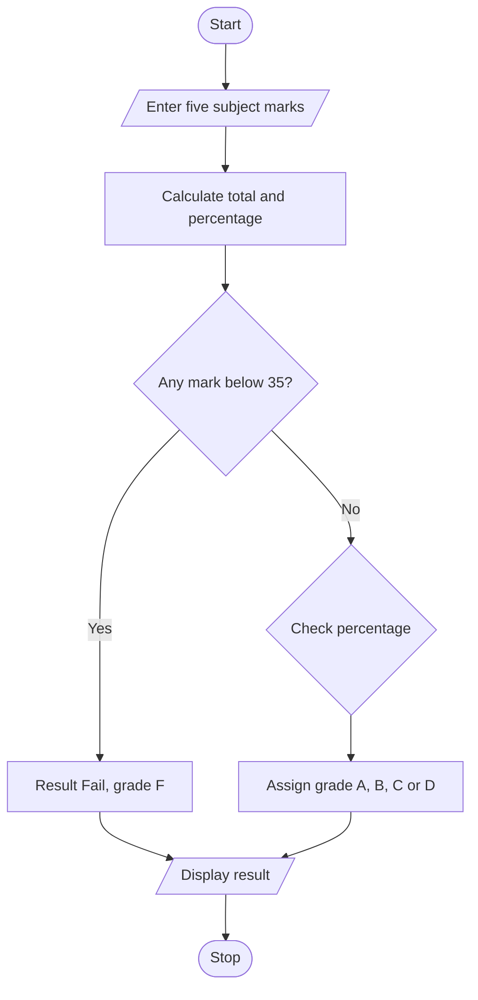

# Project 01: Student Grade Calculator

## Problem statement
Write a Python program to accept marks in five subjects and calculate total marks, percentage, pass/fail result and grade.

## Objectives
- Practise input, type conversion and arithmetic operators.
- Use lists and loops to collect marks.
- Apply `if-elif-else` decision statements.

## Assumptions
- There are five subjects, each out of 100.
- A mark must be between 0 and 100.
- A student must score at least 35 in every subject to pass.
- Grade thresholds: A = 90% and above; B = 75–89.99%; C = 60–74.99%; D = 35–59.99%; otherwise F.

## Algorithm
1. Create an empty list for marks.
2. Read and validate marks for five subjects.
3. Calculate the total and percentage.
4. If any subject mark is below 35, report fail.
5. Otherwise assign a grade based on percentage.
6. Display total, percentage, result and grade.

## Pseudocode
```text
START
marks = empty list
REPEAT for 5 subjects
    INPUT mark
    WHILE mark is outside 0..100
        INPUT mark again
    ADD mark to marks
total = sum(marks)
percentage = total / 5
IF any mark < 35
    result = Fail; grade = F
ELSE IF percentage >= 90: grade = A
ELSE IF percentage >= 75: grade = B
ELSE IF percentage >= 60: grade = C
ELSE: grade = D
DISPLAY total, percentage, result, grade
STOP
```

## Flowchart


## Source code
Run `python main.py`.

## Test cases

| Marks | Expected result |
|---|---|
| 90, 92, 88, 95, 91 | Pass, grade A |
| 70, 75, 65, 80, 72 | Pass, grade C |
| 80, 70, 30, 90, 85 | Fail, grade F |
| 35, 35, 35, 35, 35 | Pass, grade D |

## Sample output
```text
Enter marks for subject 1 (0-100): 90
Enter marks for subject 2 (0-100): 92
Enter marks for subject 3 (0-100): 88
Enter marks for subject 4 (0-100): 95
Enter marks for subject 5 (0-100): 91

Total marks: 456 out of 500
Percentage: 91.20%
Result: Pass
Grade: A
```

## Conclusion
The program demonstrates lists, loops, input validation, arithmetic and conditional statements.
