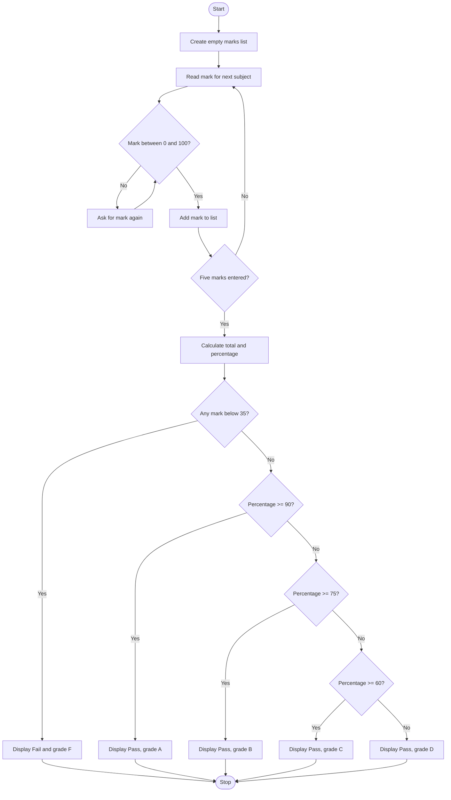

# Student Grade Calculator — Algorithm and Flowchart

## Algorithm
1. Start.
2. Create an empty list to store marks.
3. Repeat for five subjects: read a mark; while it is below 0 or above 100, ask again; add the valid mark to the list.
4. Add all five marks to get the total and divide the total by 5 to calculate the percentage.
5. If any subject mark is below 35, display Fail and grade F.
6. Otherwise, assign grade A for 90% or above, B for 75% or above, C for 60% or above, and D for 35% or above.
7. Display total, percentage, result, and grade.
8. Stop.

## Flowchart

