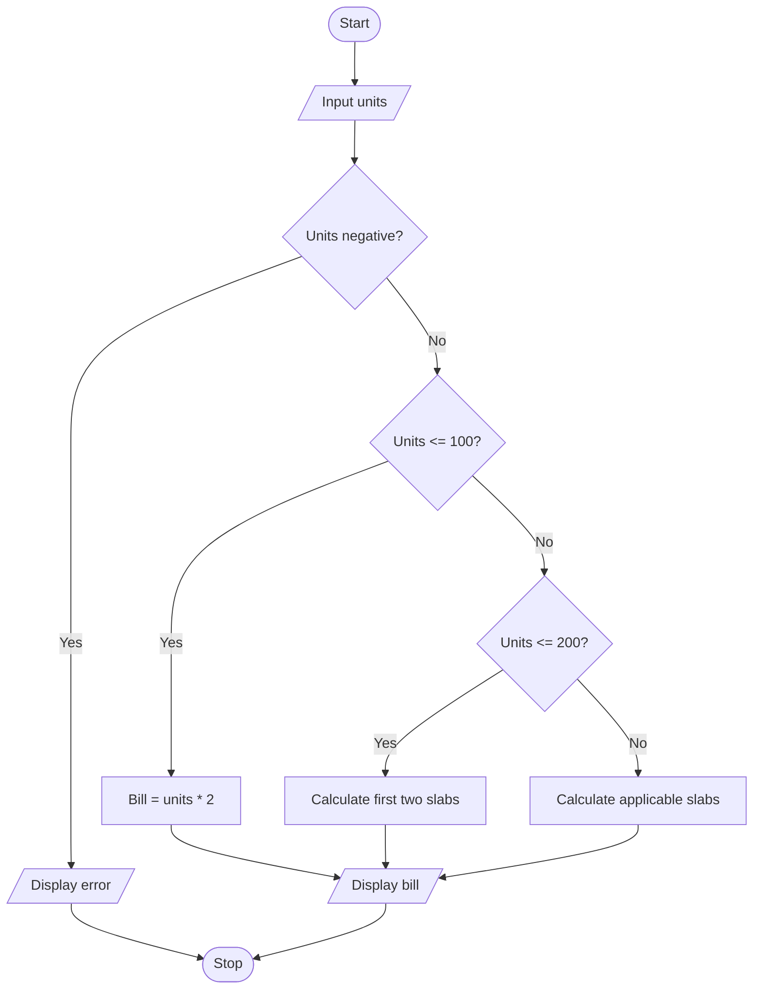

# Project 02: Electricity Bill Calculator

## Problem statement
Calculate an electricity bill from the number of units consumed using a simple progressive slab-rate model.

## Objectives
Practise numeric input, arithmetic operators, relational operators and nested decision-making.

## Assumptions
These are example rates for demonstrating the algorithm, not official utility tariffs:
- First 100 units: Rs. 2 per unit
- Next 100 units: Rs. 3 per unit
- Next 100 units: Rs. 5 per unit
- Units above 300: Rs. 7 per unit
- Fixed charges and taxes are not included.

## Algorithm
1. Read units consumed.
2. If units are negative, display an error.
3. Otherwise calculate the cost across the applicable slabs.
4. Display the units and bill.

## Pseudocode
```text
START
INPUT units
IF units < 0
    DISPLAY error
ELSE IF units <= 100
    bill = units * 2
ELSE IF units <= 200
    bill = 100*2 + (units-100)*3
ELSE IF units <= 300
    bill = 100*2 + 100*3 + (units-200)*5
ELSE
    bill = 100*2 + 100*3 + 100*5 + (units-300)*7
DISPLAY bill
STOP
```

## Flowchart


## Source code
Run `python main.py`.

## Test cases

| Units | Expected bill |
|---:|---:|
| 50 | Rs. 100.00 |
| 150 | Rs. 350.00 |
| 250 | Rs. 750.00 |
| 350 | Rs. 1450.00 |
| -5 | Error message |

## Sample output
```text
Enter electricity units consumed: 150
Units consumed: 150.0
Electricity bill: Rs. 350.00
```

## Conclusion
The program uses arithmetic and conditional statements to calculate a bill using progressive slabs.
