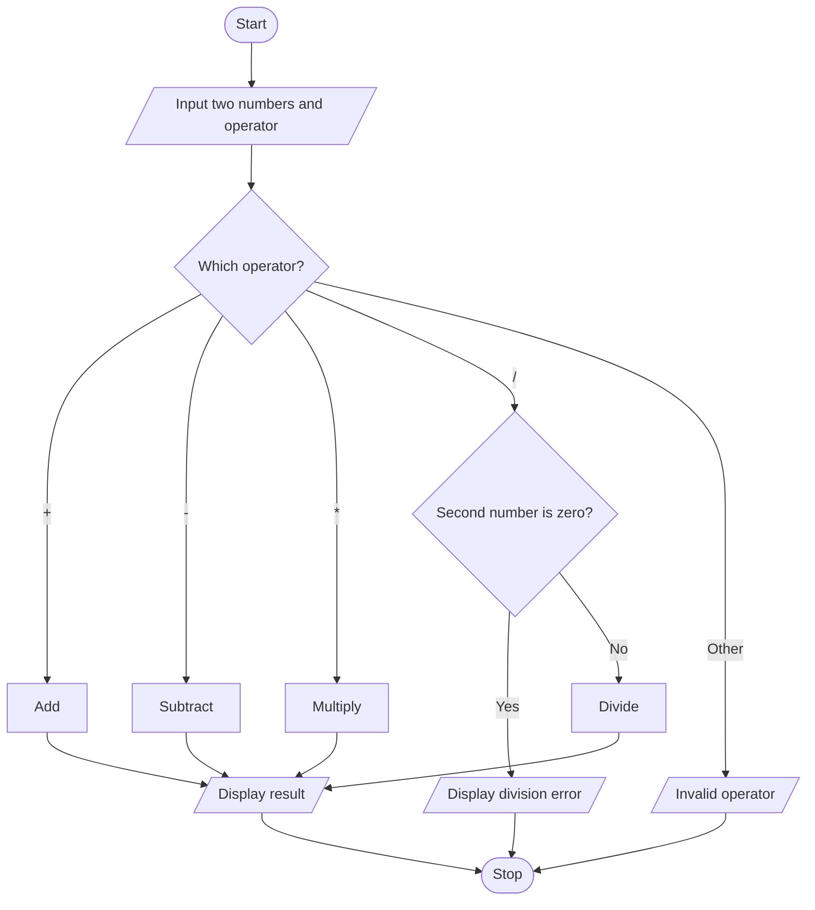

# Project 03: Simple Calculator

## Problem statement
Create a calculator that performs addition, subtraction, multiplication or division on two numbers.

## Objectives
Practise input, type conversion, arithmetic operators and an `if-elif-else` ladder.

## Assumptions
- The user enters two numeric values.
- Only `+`, `-`, `*` and `/` are supported.
- Division by zero is not allowed.

## Algorithm
1. Read the first number, operator and second number.
2. Check which operator was entered.
3. Perform the corresponding operation.
4. Check for division by zero before dividing.
5. Display the result or an error message.

## Pseudocode
```text
START
INPUT first, operator, second
IF operator is +
    answer = first + second
ELSE IF operator is -
    answer = first - second
ELSE IF operator is *
    answer = first * second
ELSE IF operator is /
    IF second = 0: DISPLAY error
    ELSE: answer = first / second
ELSE
    DISPLAY invalid operator
DISPLAY answer when calculated
STOP
```

## Flowchart


## Source code
Run `python main.py`.

## Test cases

| First | Operator | Second | Expected |
|---:|:---:|---:|---|
| 8 | + | 2 | 10 |
| 8 | - | 2 | 6 |
| 8 | * | 2 | 16 |
| 8 | / | 2 | 4 |
| 8 | / | 0 | Division error |
| 8 | % | 2 | Invalid operator |

## Sample output
```text
Enter the first number: 8
Enter an operator (+, -, *, /): *
Enter the second number: 2
Result: 16.0
```

## Conclusion
The calculator demonstrates arithmetic operations and conditional selection.
