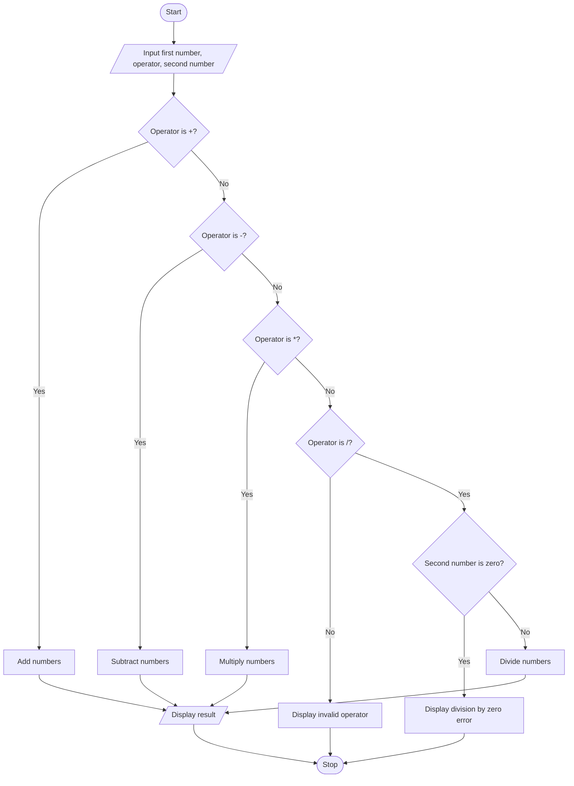

# Simple Calculator — Algorithm and Flowchart

## Algorithm
1. Start.
2. Read the first number, an arithmetic operator, and the second number.
3. If the operator is +, add the numbers.
4. Else if it is -, subtract the second number from the first.
5. Else if it is *, multiply the numbers.
6. Else if it is /, check whether the second number is zero. If it is zero, display a division-by-zero error; otherwise divide.
7. If the operator is not supported, display an invalid-operator message.
8. Stop.

## Flowchart

