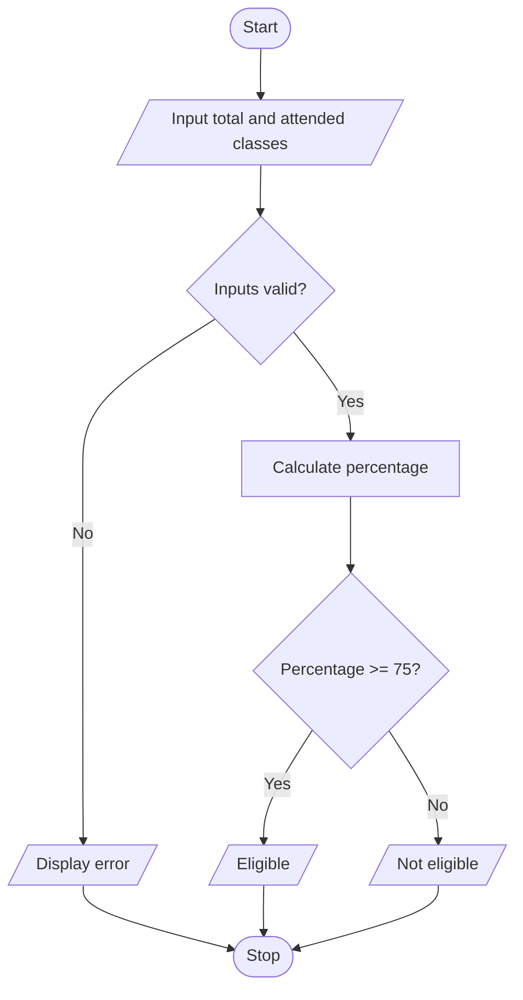

# Project 04: Student Attendance Eligibility Checker

## Problem statement
Calculate a student's attendance percentage and determine whether it meets a 75% threshold.

## Objectives
Use input, arithmetic, relational and logical operators, and conditional statements.

## Assumptions
- The eligibility threshold is 75% for this example.
- Total classes must be positive.
- Attended classes must be between zero and total classes.

## Algorithm
1. Read total classes and attended classes.
2. Validate both values.
3. Calculate attendance percentage.
4. If percentage is at least 75, display eligible; otherwise display not eligible.

## Pseudocode
```text
START
INPUT total, attended
IF total <= 0
    DISPLAY invalid total
ELSE IF attended < 0 OR attended > total
    DISPLAY invalid attendance
ELSE
    percentage = attended / total * 100
    IF percentage >= 75
        DISPLAY Eligible
    ELSE
        DISPLAY Not eligible
STOP
```

## Flowchart


## Source code
Run `python main.py`.

## Test cases

| Total | Attended | Expected |
|---:|---:|---|
| 100 | 80 | 80%; Eligible |
| 100 | 60 | 60%; Not eligible |
| 4 | 3 | 75%; Eligible |
| 0 | 0 | Invalid total |
| 10 | 12 | Invalid attendance |

## Sample output
```text
Enter total classes held: 100
Enter classes attended: 80
Attendance percentage: 80.00%
Eligibility: Eligible
```

## Conclusion
The program calculates attendance and applies a threshold using conditions.
