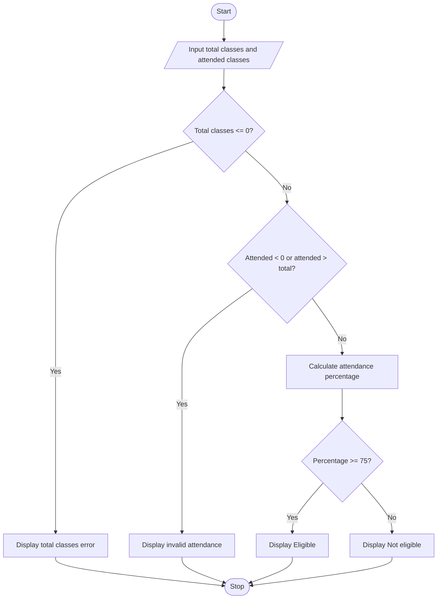

# Attendance Eligibility Checker — Algorithm and Flowchart

## Algorithm
1. Start.
2. Read total classes held and classes attended.
3. If total classes are zero or negative, display an error.
4. Else if attended classes are negative or greater than total classes, display invalid attendance.
5. Otherwise calculate attendance percentage = attended classes ÷ total classes × 100.
6. If percentage is at least 75, display Eligible; otherwise display Not eligible.
7. Stop.

## Flowchart

*Note: The 75% eligibility threshold is an example used by this project.*
