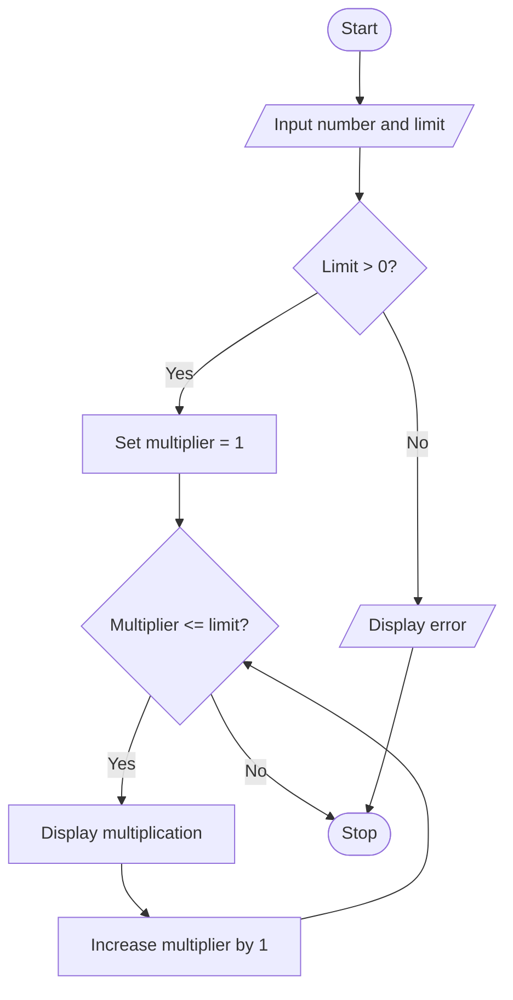

# Project 05: Multiplication Table Generator

## Problem statement
Display the multiplication table of a number up to a user-specified limit.

## Objectives
Practise integer input, the `for` loop, `range()` and arithmetic.

## Assumptions
The table limit must be a positive integer.

## Algorithm
1. Read a number and table limit.
2. If the limit is not positive, display an error.
3. Otherwise repeat from 1 through the limit.
4. Multiply the number by each multiplier and print the equation.

## Pseudocode
```text
START
INPUT number, limit
IF limit <= 0
    DISPLAY error
ELSE
    FOR multiplier from 1 to limit
        DISPLAY number, multiplier, number * multiplier
STOP
```

## Flowchart


## Source code
Run `python main.py`.

## Test cases

| Number | Limit | Expected |
|---:|---:|---|
| 5 | 3 | 5, 10, 15 |
| 7 | 10 | Table from 7 to 70 |
| 0 | 4 | Four zero results |
| 4 | 0 | Error message |

## Sample output
```text
Enter a number: 5
Enter the table limit: 3
5 x 1 = 5
5 x 2 = 10
5 x 3 = 15
```

## Conclusion
The program demonstrates repetition and arithmetic using a `for` loop.
