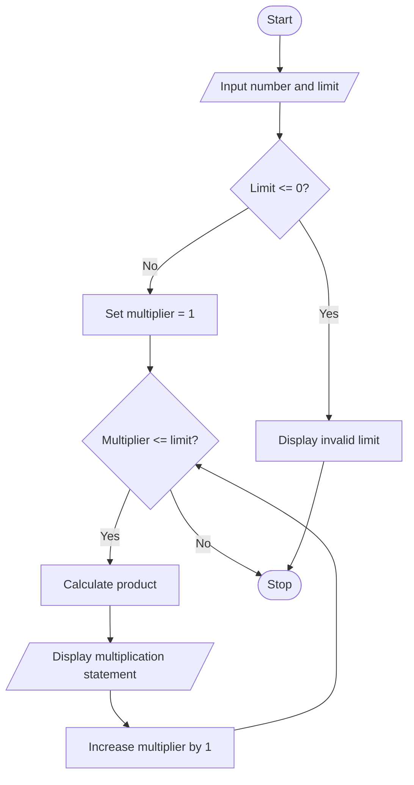

# Multiplication Table Generator — Algorithm and Flowchart

## Algorithm
1. Start.
2. Read the number and the table limit.
3. If the limit is zero or negative, display an error message.
4. Otherwise set the multiplier to 1.
5. While the multiplier is less than or equal to the limit: calculate number × multiplier, display the multiplication statement, and increase the multiplier by 1.
6. Stop.

## Flowchart

