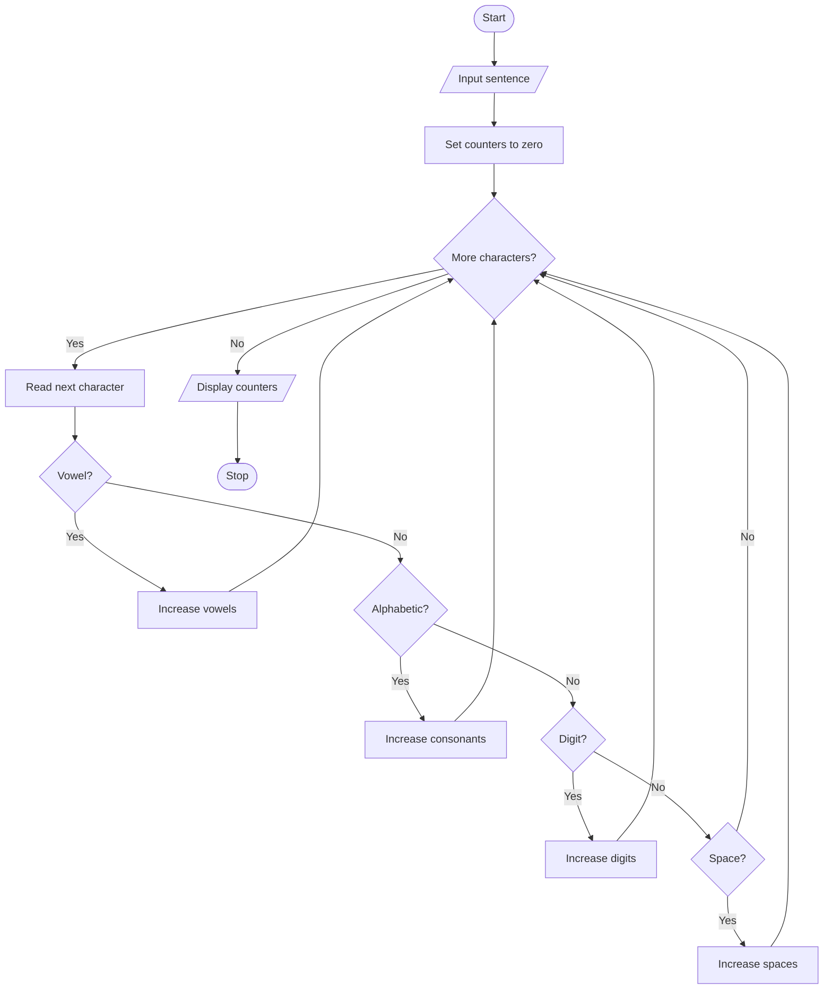

# Project 06: String Analyzer

## Problem statement
Count vowels, consonants, digits and spaces in a sentence.

## Objectives
Practise string traversal, string methods, membership testing, conditions and loops.

## Assumptions
- English alphabetic characters are counted as vowels or consonants.
- Punctuation and other characters are ignored.
- Uppercase and lowercase vowels are both counted.

## Algorithm
1. Read a sentence.
2. Set all counters to zero.
3. Visit each character.
4. Check whether it is a vowel, consonant, digit or space.
5. Increase the corresponding counter and display all counts.

## Pseudocode
```text
START
INPUT text
Set vowels, consonants, digits, spaces to 0
FOR each character in text
    IF lowercase character is in "aeiou": increase vowels
    ELSE IF character is alphabetic: increase consonants
    ELSE IF character is a digit: increase digits
    ELSE IF character is a space: increase spaces
DISPLAY all counters
STOP
```

## Flowchart


## Source code
Run `python main.py`.

## Test cases

| Input | Vowels | Consonants | Digits | Spaces |
|---|---:|---:|---:|---:|
| `Hello 123` | 2 | 3 | 3 | 1 |
| `Python` | 1 | 5 | 0 | 0 |
| `AEIOU` | 5 | 0 | 0 | 0 |
| Empty input | 0 | 0 | 0 | 0 |

## Sample output
```text
Enter a sentence: Hello 123
Vowels: 2
Consonants: 3
Digits: 3
Spaces: 1
```

## Conclusion
The program demonstrates string methods, loops and character classification.
