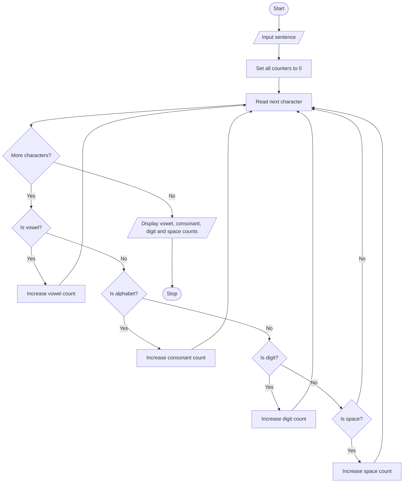

# String Analyzer — Algorithm and Flowchart

## Algorithm
1. Start.
2. Read a sentence.
3. Initialize vowel, consonant, digit, and space counters to zero.
4. Visit each character in the sentence.
5. If the lowercase character is a, e, i, o, or u, increase the vowel counter.
6. Else if it is an alphabetic character, increase the consonant counter.
7. Else if it is a digit, increase the digit counter.
8. Else if it is a space, increase the space counter.
9. Display all four counts.
10. Stop.

## Flowchart

