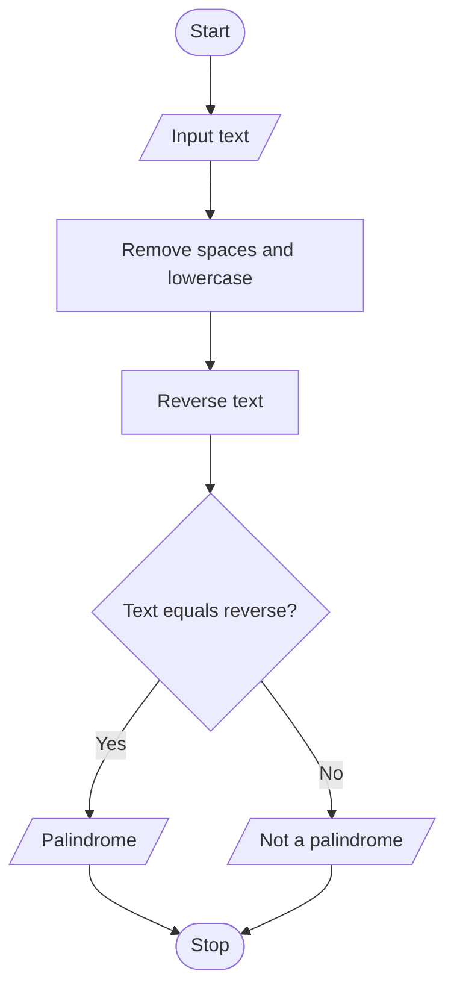

# Project 07: Palindrome Checker

## Problem statement
Determine whether a word or sentence is a palindrome, ignoring spaces and letter case.

## Objectives
Practise strings, string methods, slicing and conditional statements.

## Assumptions
Only spaces and letter case are ignored. Punctuation is not removed.

## Algorithm
1. Read the input text.
2. Remove spaces and convert the text to lowercase.
3. Reverse the cleaned text using slicing.
4. Compare the cleaned text with its reverse.
5. Display whether it is a palindrome.

## Pseudocode
```text
START
INPUT text
cleaned = lowercase(text with spaces removed)
reversed_text = reverse(cleaned)
IF cleaned equals reversed_text
    DISPLAY palindrome
ELSE
    DISPLAY not palindrome
STOP
```

## Flowchart


## Source code
Run `python main.py`.

## Test cases

| Input | Expected |
|---|---|
| madam | Palindrome |
| Level | Palindrome |
| never odd or even | Palindrome |
| python | Not a palindrome |

## Sample output
```text
Enter a word or sentence: Level
It is a palindrome.
```

## Conclusion
The program uses string methods and reverse slicing to test a palindrome.
