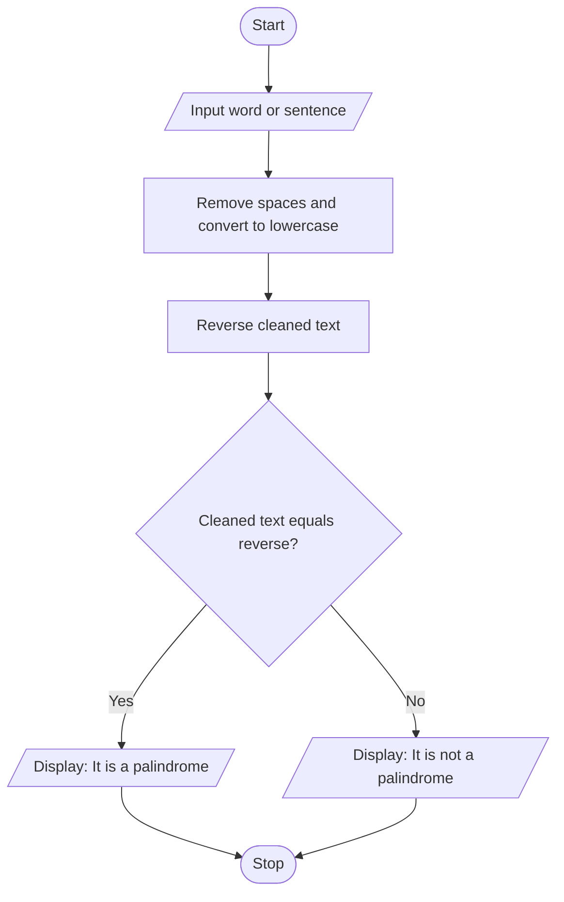

# Palindrome Checker — Algorithm and Flowchart

## Algorithm
1. Start.
2. Read a word or sentence.
3. Remove spaces and convert all letters to lowercase.
4. Reverse the cleaned text using string slicing.
5. If the cleaned text is equal to its reverse, display that it is a palindrome.
6. Otherwise display that it is not a palindrome.
7. Stop.

## Flowchart

*Note: Spaces and letter case are ignored; punctuation is not removed by the current program.*
