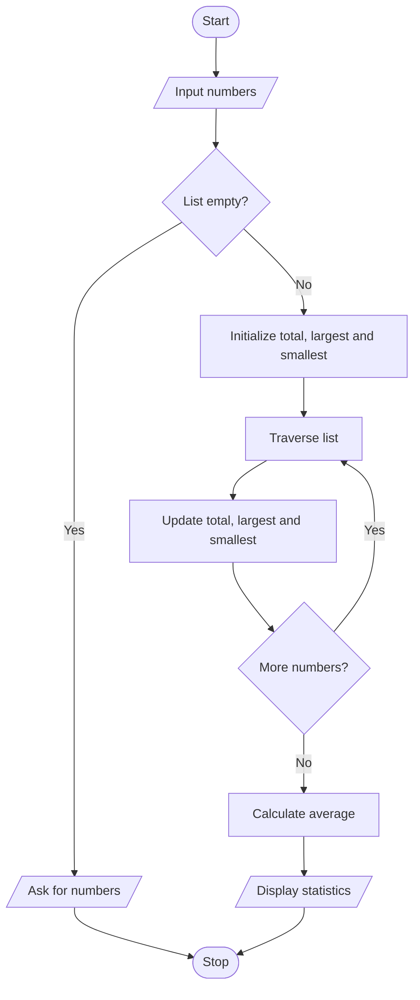

# Project 08: List Statistics Calculator

## Problem statement
Read a list of numbers and calculate its sum, average, largest value and smallest value.

## Objectives
Practise lists, list traversal, type conversion, loops and arithmetic.

## Assumptions
- Enter one or more valid numbers separated by spaces.
- The program accepts whole numbers and decimal numbers.
- Invalid non-numeric text is outside this beginner version's input assumptions.

## Algorithm
1. Read the numbers as a line of text and split it into parts.
2. If no numbers are entered, display a message.
3. Convert each part to a number and store it in a list.
4. Traverse the list to calculate the sum and find largest and smallest values.
5. Calculate average and display all results.

## Pseudocode
```text
START
INPUT numbers separated by spaces
parts = split input
IF parts is empty
    DISPLAY input message
ELSE
    Convert parts to numeric list
    total = 0
    largest = first item
    smallest = first item
    FOR each number
        Add number to total
        Update largest and smallest if needed
    average = total / number of items
    DISPLAY total, average, largest, smallest
STOP
```

## Flowchart


## Source code
Run `python main.py`.

## Test cases

| Input | Sum | Average | Largest | Smallest |
|---|---:|---:|---:|---:|
| `2 4 6` | 12 | 4.00 | 6 | 2 |
| `10` | 10 | 10.00 | 10 | 10 |
| `-3 3 0` | 0 | 0.00 | 3 | -3 |
| Empty input | — | — | — | — |

## Sample output
```text
Enter numbers separated by spaces: 2 4 6
Numbers: [2.0, 4.0, 6.0]
Sum: 12.0
Average: 4.00
Largest: 6.0
Smallest: 2.0
```

## Conclusion
The program demonstrates list creation, traversal and calculations without relying on advanced libraries.
