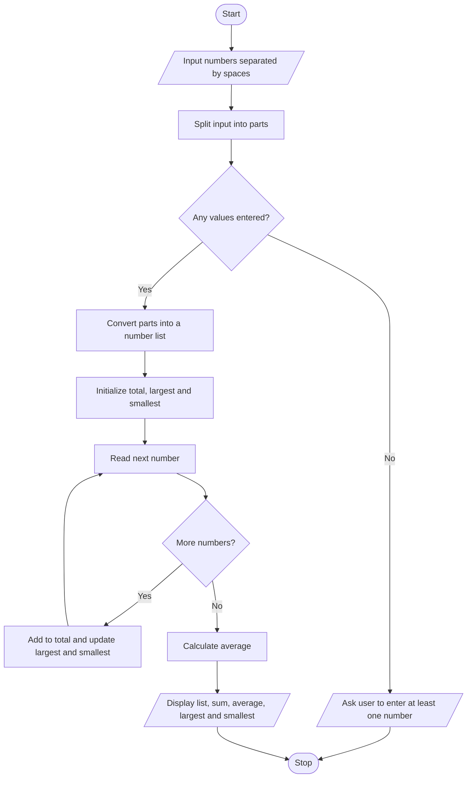

# List Statistics Calculator — Algorithm and Flowchart

## Algorithm
1. Start.
2. Read numbers separated by spaces and split the input into parts.
3. If no numbers were entered, display a message asking for at least one number.
4. Otherwise convert each part to a number and store the values in a list.
5. Initialize total to 0, and largest and smallest to the first list item.
6. Visit each number: add it to total; update largest if it is greater; update smallest if it is smaller.
7. Calculate average = total ÷ number of items.
8. Display the list, sum, average, largest, and smallest values.
9. Stop.

## Flowchart

*The algorithm assumes each entered item can be converted to a number.*
