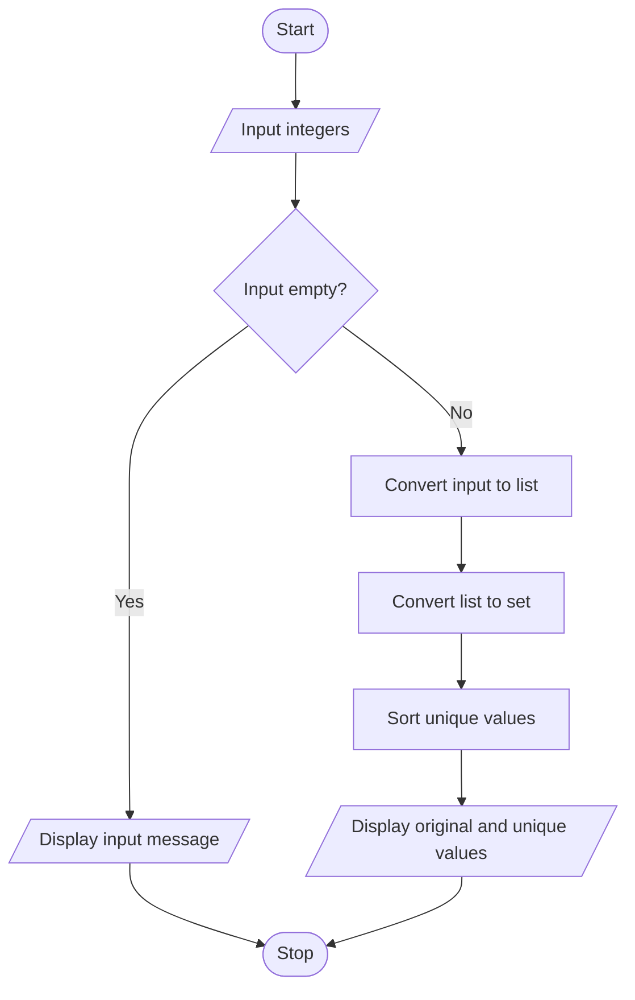

# Project 09: Duplicate Element Remover

## Problem statement
Accept a list of integers and display its distinct values without duplicates.

## Objectives
Practise lists, sets, type conversion and membership concepts.

## Assumptions
- The input contains integers separated by spaces.
- The unique values are displayed in sorted order for consistent output.
- An empty input produces a message.

## Algorithm
1. Read integers separated by spaces.
2. Split the input and check whether it is empty.
3. Convert the parts to integers and store them in a list.
4. Convert the list to a set to remove duplicates.
5. Sort and display the unique values.

## Pseudocode
```text
START
INPUT integer values
Split input into parts
IF no parts
    DISPLAY input message
ELSE
    Convert parts into a list of integers
    unique_values = set(list)
    DISPLAY original list
    DISPLAY sorted unique_values
STOP
```

## Flowchart


## Source code
Run `python main.py`.

## Test cases

| Input | Expected unique values |
|---|---|
| `1 2 2 3 1` | `[1, 2, 3]` |
| `5 5 5` | `[5]` |
| `-1 0 -1 2` | `[-1, 0, 2]` |
| Empty input | Input message |

## Sample output
```text
Enter integers separated by spaces: 1 2 2 3 1
Original list: [1, 2, 2, 3, 1]
Unique elements: [1, 2, 3]
```

## Conclusion
The program demonstrates how a set stores unique values and how a list can be traversed and converted.
