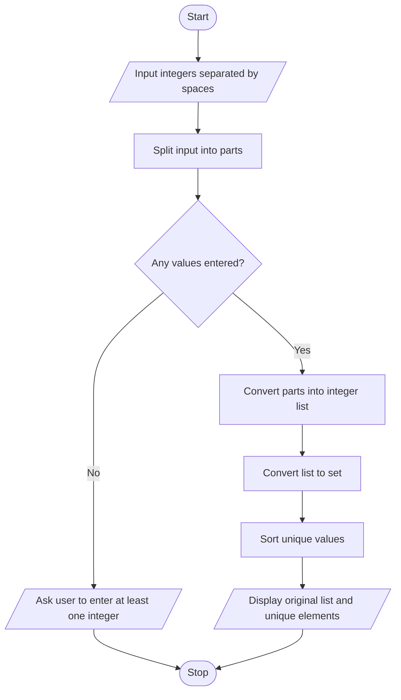

# Duplicate Element Remover — Algorithm and Flowchart

## Algorithm
1. Start.
2. Read integers separated by spaces and split the input.
3. If the input is empty, ask the user to enter at least one integer.
4. Otherwise convert each part to an integer and store the values in a list.
5. Convert the list to a set to keep only distinct values.
6. Sort the distinct values.
7. Display the original list and the sorted unique elements.
8. Stop.

## Flowchart

*The set removes duplicates; sorting makes the displayed unique values appear in ascending order.*
