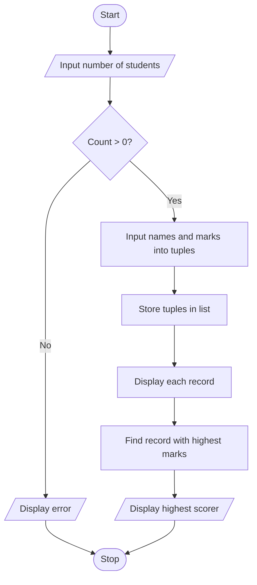

# Project 10: Student Records Using Lists and Tuples

## Problem statement
Store student names and marks, display all records and identify the student with the highest marks.

## Objectives
Practise lists, tuples, nested data structures, loops, tuple unpacking and comparisons.

## Assumptions
- The number of students must be greater than zero.
- Marks are numeric.
- Each record is stored as a tuple containing a name and marks.

## Algorithm
1. Read the number of students.
2. If it is not positive, display a message.
3. Otherwise read each student's name and marks.
4. Store each record as a tuple in a list.
5. Traverse and display all records.
6. Traverse the list to find and display the highest scorer.

## Pseudocode
```text
START
INPUT count
IF count <= 0
    DISPLAY error
ELSE
    students = empty list
    REPEAT count times
        INPUT name and marks
        APPEND tuple (name, marks) to students
    FOR each record
        UNPACK name and marks
        DISPLAY record
    highest = first record
    FOR each record
        IF record marks > highest marks
            highest = record
    DISPLAY highest scorer
STOP
```

## Flowchart


## Source code
Run `python main.py`.

## Test cases

| Students (name, marks) | Expected highest scorer |
|---|---|
| Asha: 80; Ravi: 92; Noor: 75 | Ravi, 92 |
| Kim: 65 | Kim, 65 |
| Count = 0 | Error message |

## Sample output
```text
How many students? 3
Enter student name: Asha
Enter marks for Asha: 80
Enter student name: Ravi
Enter marks for Ravi: 92
Enter student name: Noor
Enter marks for Noor: 75

Student Records
Name: Asha | Marks: 80.0
Name: Ravi | Marks: 92.0
Name: Noor | Marks: 75.0

Highest scorer: Ravi
Highest marks: 92.0
```

## Conclusion
The program demonstrates storing related data in tuples, collecting records in a list, unpacking tuples and traversing records.
