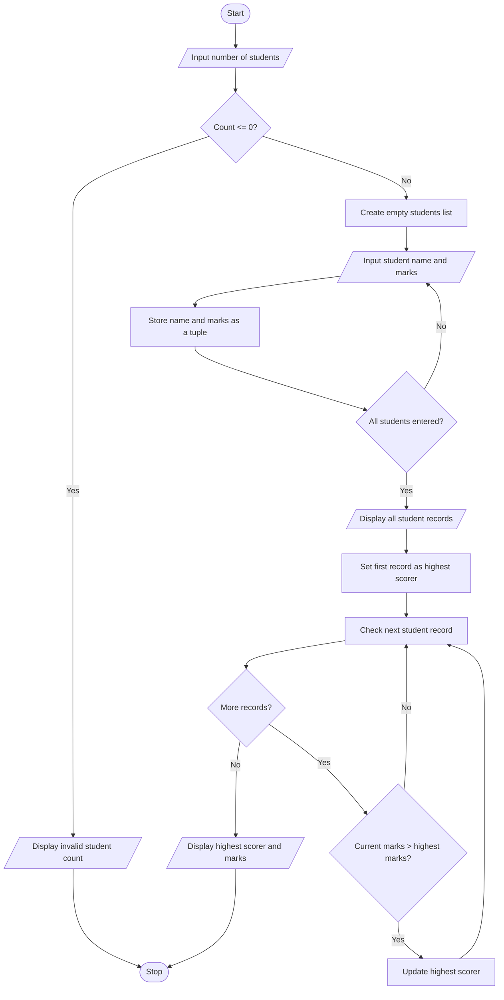

# Student Records — Algorithm and Flowchart

## Algorithm
1. Start.
2. Read the number of students.
3. If the count is zero or negative, display an error message.
4. Otherwise repeat for each student: read the student's name and marks; store them together as a tuple in the students list.
5. Display every student record.
6. Set the first student record as the current highest scorer.
7. Visit each student record. If the student's marks are greater than the current highest marks, update the highest scorer.
8. Display the highest scorer's name and marks.
9. Stop.

## Flowchart

*Each record is stored as a tuple containing the student's name and marks.*
